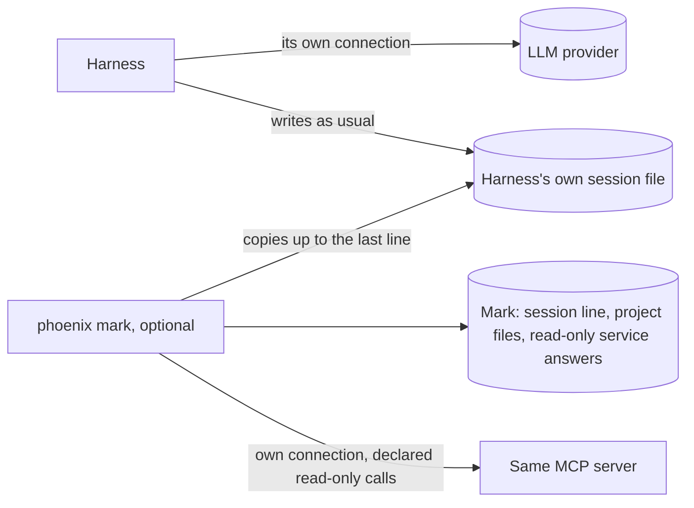
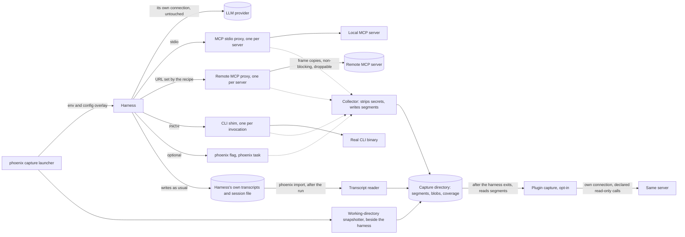
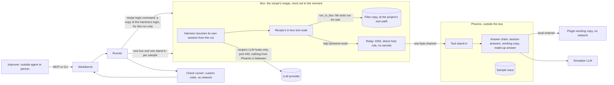
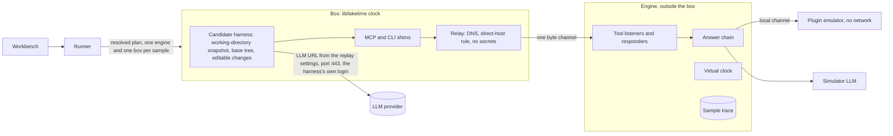

# Phoenix: Architecture

Status: November 16, 2026. Built from SPEC.md, and updated for ADR 0007: a replay resumes the harness's own session, and nothing from Phoenix sits between a harness and its LLM (JOH-44).

## 0. The shape

Phoenix is a TypeScript monorepo run with `npx`. A harness records its own runs: it saves a session file with every message, tool call and tool result. Phoenix adds nothing live to make that happen.

A **Moment** is a directory of plain files (manifest, success check, lock, data) that can sit in git. Most moments come from a session file. `phoenix moment create --session` has the harness's recipe cut a copy of that file just before the user turn that holds a given line, or keep it whole to start from the first message. `phoenix mark` saves the session's line, a copy of the project's files and, with a plugin, what each service's read-only tools answered, while the harness runs, and a moment can be made from that mark. A made-up moment is written by hand, and the recipe turns it into a session file. A person approves the moment's check, and the approval is recorded in a ledger outside every workspace that the Workbench can't write.

A Replay runs a candidate harness in a container. On the main path the container starts the recipe's image, and the harness resumes its own session from the cut. It talks straight to its LLM, with a copy of its own login that exists only for the run. The box's only way out is the recipe's LLM hosts on port 443. Every other connection, DNS included, ends at Phoenix. Phoenix answers tool calls through a stand-in, in this order: answers saved at a mark or written for a made-up moment; the session's own recorded results; a service's working copy; a made-up answer from the simulator LLM. A file tool call the session never made runs for real on a copy of the project's files instead of getting a made-up answer. When none of these applies, the replay stops.

A moment made from a Phoenix capture alone, with no session file, replays from the beginning only. The runner builds the box from the captured working directory and the candidate. It sets the harness's LLM URL setting to the URL in the replay settings and passes in the harness's own LLM login from the host environment. Tool calls go to the Phoenix **engine**, whose **answer chain** works in this order: world, recording, overlay, emulator, capture-time reads, simulator, divergence. The engine has no LLM route.

Capture is optional. For each surface the person picks routes. **In-path routes** use a **tap**: the MCP proxy (stdio servers, and Streamable HTTP for remote servers) and the CLI proxy. A tap relays traffic unchanged. Through its **tee** it forwards each frame first and only then offers a copy to a per-capture **collector**, using a bounded, non-blocking send. It never waits on the collector, the disk or redaction. When a copy can't be taken, the frame still goes through and the record shows a marked gap. The collector strips secrets and writes one append-only segment per stream. **After-the-fact routes** read the harness's own transcripts or session logs once the run is over. No route touches the harness's LLM traffic. By default one launch is one Run. A long-lived server harness marks its tasks by session or thread id, or with a marker call. The working directory is snapshotted at the start of each run, beside the harness and never ahead of it. The setup step fills in whatever the chosen routes missed, and tags each filled answer derived or synthesized.

Every result says which answers were real, recorded, derived, seeded or synthesized. A resumed replay also counts the answers that came from the session, the files copy, a working copy, and the simulator. A recorded answer is used only while the Replay's writes on that connector match the writes the original run had made at that point. Samples per moment start at 2, with a 3rd when the first two disagree. A pass that rests on synthesized answers is discounted and counts for nothing until it is confirmed. The Workbench is a thin API over the runner, exposed as an MCP server and a matching CLI, and it has no code that can write a success check or the ledger. Every language-neutral format is a versioned JSON Schema. Plugins and recipes are separate processes or data files, so the core works with none installed.

## 1. Runtime picture

**A live run.** Nothing from Phoenix has to be attached. The harness talks to its LLM and writes its session file as usual. `phoenix mark` is optional.



**Optional capture (live, beside the harness, no container):**



Dotted arrows are copies. Nothing on the forwarding side waits for them, and a copy that can't be sent is dropped and counted. The launcher, the collector, each proxy and each shim is its own process. The collector is restarted by the launcher if it dies. Every recorded stream has one writer. After-the-fact routes and plugin capture touch only files and their own connections. No proxy sits in the harness's connection to its LLM.

**Replay of a session moment (ADR 0007, inside the Workbench):**



**Replay of a moment made from a capture alone (from the beginning only):**



In both replay paths the box can reach its LLM hosts on port 443 and Phoenix's tool listeners, and nothing else. Phoenix never sees, changes or records the traffic between the harness and its LLM. Phoenix has no long-running hosted service. All state is files, and any `phoenix` process can pick up work another one left unfinished.

## 2. Units

| Unit | Language | Owns | May depend on | Must never depend on |
|---|---|---|---|---|
| `spec` | JSON Schema, Markdown | Versioned definitions of the trace, working-directory snapshot, moment manifest, made-up moment, fills, success check, lock, approvals ledger, harness contract, bindings, plugin descriptor, recipe descriptor, replay plan and replay result | nothing | any code |
| `formats` | TypeScript | Types generated from `spec`, validators, version checks | `spec` | every other unit |
| `store` | TypeScript | Capture directories: segment writer, blob store and spool, merged reader with run and task attribution, crash recovery. Moment bundle reader and writer. Reading the approvals ledger | `formats` | taps, answer, engine, workbench |
| `redact` | TypeScript | Pure secret stripping for capture and pure personal-data scrubbing for packing | `formats` | I/O of any kind |
| `wire` | TypeScript | Pure codecs: MCP framing for both protocol eras; CLI invocation records; HTTP exchanges; canonical JSON and call keys; write histories; format inference; the mechanical fill derivations | `formats` | I/O of any kind |
| `taps` | TypeScript | One listener per tool surface, each given a `Backend` | `wire`, `formats` | `capture`, `answer`, any knowledge of live versus replay |
| `capture` | TypeScript | Launcher, collector, upstream backends, the tee, working-directory snapshotter, task markers, recipe application, flag and correction commands, `phoenix mark`, plugin capture host | `taps`, `store`, `redact`, `plugin-host`, `formats` | `answer`, `engine`, `runner`, `workbench`, `checks`, `approvals` |
| `transcripts` | TypeScript | Runs recipe transcript readers and `phoenix record`, validates their events, strips secrets, writes import segments | `store`, `redact`, `formats` | `taps`, `capture`, `answer`, `engine` |
| `model` | TypeScript | The `ModelProvider` port and its HTTP adapter: Phoenix's own LLM calls for the simulator, gap filling and check drafting, never the harness's | `formats` | everything else |
| `answer` | TypeScript | Answer chain, matcher, write histories, made-up world answers, entity overlay, prefetch and simulator resolvers, divergence | `wire`, `store`, `plugin-host`, `model`, `formats` | `taps`, `sandbox`, `workbench`, any live vendor client |
| `engine` | TypeScript | Replay-side tool servers: taps wired to responders over the answer chain, the tool stand-in for resumed sessions, virtual clock, sample trace. No LLM route | `taps`, `answer`, `store`, `redact`, `formats` | `workbench`, `setup` |
| `sandbox` | TypeScript, shell | `Sandbox` port, container driver, the relay and its direct-host rule for LLM hosts, the clock file and probe | `formats` | everything else |
| `checks` | TypeScript | Deterministic expectation evaluators, custom-check host, taint, sample and moment verdicts, discount confirmation | `store`, `wire`, `sandbox`, `formats` | `engine`, `workbench`, `setup` |
| `fidelity` | TypeScript | Tier and grade rules and the fidelity report, all computed from a trace | `store`, `wire`, `formats` | `engine`, `workbench` |
| `runner` | TypeScript | Resolves a replay plan, runs samples on the resume path or the generic path, starts a fresh attempt for an interrupted sample on the next resume, applies the sample rule, reuses baselines, records results | `engine`, `sandbox`, `checks`, `fidelity`, `store`, `formats` | `workbench`, `setup`, `approvals` |
| `approvals` | TypeScript | The only functions that append to the approvals ledger: check approval and auto-lock, moment acceptance, pass acceptance | `store`, `formats` | `workbench`, `runner`, `engine`, any network |
| `setup` | TypeScript | Turns a session file, a mark, a made-up moment, a capture or a Scenario into a moment bundle: has the recipe read the cut, copies the project's files, finds connectors, fills gaps, classifies operations, picks tiers, drafts the check, locks it through `approvals`. Also builds packed revisions for sharing | `store`, `wire`, `redact`, `plugin-host`, `model`, `approvals`, `formats` | `workbench`, `runner` |
| `workbench` | TypeScript | `WorkbenchApi`, its MCP server and CLI, workspaces, candidate freezing, patch and pull-request output | `runner`, `store`, `checks`, `fidelity`, `formats` | `setup`, `approvals`, any code that writes a check or the ledger |
| `plugin-host` | TypeScript | Finds plugin descriptors, starts plugin processes, speaks the plugin protocol | `sandbox`, `formats` | any specific plugin |
| `plugin-kit` | TypeScript | The connector test kit: runs recorded exchanges through a plugin and reports differences | `plugin-host`, `store`, `wire`, `formats` | `workbench` |
| `cli` | TypeScript | The `phoenix` binary, and the only place units are wired together | all units | nothing barred |
| `recipes/*` | YAML, scripts in any language | One recipe per harness: its transcript reader, its capture overlay, and, where the harness can be resumed, how to read, cut and resume its session and which LLM hosts it uses | `spec` | core internals |
| `plugins/*` | any | Connector plugins, each separately installed | `spec` | core internals |
| `reference-harness` | TypeScript | The small from-scratch harness | the harness contract in `spec`, the official MCP client SDK | every Phoenix package |

`redact`, `wire`, the matcher in `answer`, and the evaluators in `checks` and `fidelity` are pure functions over files. Each can be checked by feeding it a recorded trace, with no vendor and no container running.

## 3. Core pieces

### 3.1 Taps, links and backends

A tap owns one tool surface's transport and nothing else. It knows where a message starts and ends, not what it means. No tap carries the harness's LLM traffic.

```ts
interface Frame {
  dir: "out" | "back";     // out: harness toward tool; back: tool toward harness
  stream: number;          // one message or body within the connection
  bytes: Uint8Array;
  last: boolean;           // this frame completes a message
  at: bigint;              // host monotonic clock when seen
}
interface Link {
  write(f: Frame): Promise<void>;
  frames(): AsyncIterable<Frame>;
  abort(why: string): void;
}
interface Backend {
  open(conn: { surface: Surface; connector: string; meta: unknown }): Link;
}
```

A link is two-way and long-lived, so every protocol pattern fits without a special case. On stdio that means JSON-RPC lines in both directions. On Streamable HTTP it means a POST and its request-scoped SSE stream. For MCP revisions up to 2025-11-25 it also covers the session header, the standalone GET stream, server-initiated requests, cancellation and `Last-Event-ID` resumption ([2025-11-25 transports](https://modelcontextprotocol.io/specification/2025-11-25/basic/transports)). The 2026-07-28 revision removes the handshake, sessions and resumability. It carries the protocol version in each request's `_meta`, adds `server/discover`, delivers change notifications on a `subscriptions/listen` stream, and replaces server-initiated requests with `input_required` results that the client retries ([2026-07-28 changelog](https://modelcontextprotocol.io/specification/2026-07-28/changelog), [transports](https://modelcontextprotocol.io/specification/2026-07-28/basic/transports)). Both eras are just frames on streams.

There are four taps:

- **MCP stdio.** A process that sits where the server command used to be and relays newline-delimited JSON-RPC both ways. Some clients probe a stdio server by launching a disposable second copy ([SDK guide](https://ts.sdk.modelcontextprotocol.io/v2/migration/support-2026-07-28.html)). When that happens, a second proxy relays to a second server process.
- **MCP Streamable HTTP.** `mcpHttpTap`, an HTTP listener for one remote server. Capture runs it as `phoenix mcp-http-proxy <name> <url>`.
- **CLI.** A shim placed first on `PATH` for each command the recipe names. It carries these things:
  - argv as an array, never a joined shell string;
  - the working directory and an allow-listed slice of the environment;
  - stdin, stdout and stderr;
  - the exit code or signal.

  Each descriptor gets a pseudoterminal only if the shim's own descriptor is a terminal, along with the terminal size, resize events and forwarded signals. Otherwise it gets a pipe.
- **HTTP.** `httpTap`, one HTTP listener that routes each request to a connector. `mcpHttpTap` is built on it. In a Replay the engine's tool listener is an `httpTap`: it serves remote MCP entries on `/mcp/<connector>` routes and direct HTTP connectors by host. This is tool traffic only.

Every tap keeps these rules:

1. A tap never rewrites a message, never answers one itself, never decodes a body, and never adds a request of its own (no discovery probe, no protocol upgrade, no change to the tool list). Meaning is decoded later from the recorded copy by `wire`.
2. A tap does not know whether it is live or in a replay. That depends only on the backend it was given.
3. In Capture, the only recording work on a tap's path is the tee's non-blocking copy (section 3.2). A tap never awaits anything to do with recording.
4. The trace format can mark traffic underneath a tool with `layer: "under"`, and link it to a parent call. Setup, checks and fidelity count only agent-level calls. No capture route writes under-layer traffic today.

### 3.2 Capture

Capture is optional. A replay is built from the harness's own session file, and Phoenix never records the harness's LLM traffic. When a person does capture, the routes are their choice, set for each surface through the recipe's options. They come in two kinds, and a person can combine them:

- **In-path routes**: the MCP proxy and the CLI proxy. Each one is a tap.
- **After-the-fact routes**: the harness's own transcripts or session logs, and any script that writes trace events (section 3.3). Nothing is in the live path.

Every event records the route it came from. Whatever the chosen routes didn't capture is filled in later by the setup step, and each filled answer is tagged derived or synthesized (section 3.6).

`phoenix capture --recipe <recipe.yaml> [--routes <list>] -- <harness command>` is the launcher. `--routes` takes `mcp-proxy` and `cli-proxy`, both by default, and refuses any route the recipe doesn't offer. The launcher does these things in order:

1. It creates the capture directory and starts the collector as a supervised child.
2. It applies the capture recipe as an overlay for the chosen routes. The overlay puts the CLI shims first on `PATH` and writes a generated copy of the MCP config, so the person's own files are never edited.
3. It runs the harness with its stdio inherited, forwards signals to it, and starts the working-directory snapshotter beside it.
4. When the harness exits, it waits for the snapshot, stops the routes, and writes the closing coverage line. Then it runs plugin capture for any plugin it was given, and exits with the harness's exit code.

`PHOENIX_CAPTURE`, `PHOENIX_COLLECTOR` and `PHOENIX_HOME` reach every proxy and shim through the inherited environment. If the launcher itself dies, the harness and its routes keep running, and the capture ends with no `close`. The harness never depends on the launcher staying up. With an empty `--routes` list, the launcher puts nothing between the harness and anything it talks to. Its only job is then the working-directory snapshot.

- **The harness's LLM traffic.** No route touches it. The harness's own session file is the record of what it said to its LLM and what its tools returned, including tools nobody proxied.
- **MCP proxy.** The overlay rewrites each stdio server entry to `phoenix mcp-proxy <name> -- <original command>`. The server itself is untouched. The generic overlay refuses a remote entry. The Claude Code, Codex and pi recipes start `phoenix mcp-http-proxy <name> <url>` for each remote server and point the harness at it. The trace holds every message in both directions, every tool list seen (including later changes), and the protocol version actually used. On older servers that version comes from the `initialize` result. On current servers it comes from per-request `_meta` and `server/discover`.
- **Remote MCP and OAuth.** Authorization is bound to the server's own resource URL ([authorization](https://modelcontextprotocol.io/specification/2026-07-28/basic/authorization)). Phoenix never weakens token validation to make interception work. Where a proxy can't be used, the transcript route covers that server.
- **CLI proxy.** The shim starts the real binary from the rest of `PATH` first, then relays and copies. When the binary exits, the shim exits at once with the same code, or re-raises the same signal. It never waits for its copies to finish sending. A command invoked by absolute path or as a shell built-in doesn't pass through a shim, and the coverage record says so. A recorded command response doesn't record the local files that command wrote.
- **Plugin capture.** This is opt-in per connector and off by default. A connector plugin may declare a `capture` command, which the capture host runs after the harness exits.
  - It reads that connector's recorded events from the capture's segment files and never sits on a tap.
  - It asks for read-only calls over objects the agent saw. The host runs them on a **separate connection** to the same server: its own server process started from the same command for stdio, or its own requests for a remote server. The calls never share the agent's connection, its request ids or its session.
  - The host refuses any tool the plugin didn't declare read-only. Server tool annotations are never enough, because MCP says clients must treat them as untrusted ([tools](https://modelcontextprotocol.io/specification/2026-07-28/server/tools)).
  - Results are written as `prefetch` events with their own timestamps and are never sent to the harness.
- **Marking.** `phoenix mark` works with or without a capture. While the harness runs, it copies the session file up to its last complete line and takes a copy of the project's files. Given the MCP config and plugins, it also runs each plugin's read-only reads for the server the plugin recognizes, on its own connection. Run afterward with `--at <line>`, it saves only the session and the line. Section 3.6 makes a moment from it.
- **Flagging.** `phoenix flag "<reason>"` writes a mark to the current capture. An opt-in one-tool MCP server (`phoenix flag-server`) does the same for harnesses that prefer a tool. Neither is added unless the person adds it, so default Capture never changes what the agent sees.
- **Corrections.** `phoenix correct <capture> --at <event> "<text>" [--one-off]` appends a Correction to the capture's notes, either during the run or afterward. Corrections are entered only through this command.
- **Coverage record.** When a stream connects, the collector appends a line to `coverage.jsonl` giving the route, surface, server or command, and entry mode. Coverage therefore survives a capture that never closes cleanly. At close, the launcher adds the configured routes, the harness's exit, and what the routes can't see, including that the harness's LLM traffic is not recorded.

#### Runs and task boundaries

By default, one launch through `phoenix capture` is one Run. For a long-lived server harness that handles many tasks in one process, the recipe declares how tasks are told apart, using either or both of these:

- **A task key on the wire.** This is a session or thread id at a location the recipe names: an HTTP header, a field in a request's `_meta`, or a JSON path in a recorded request body. MCP's own session header exists only before the 2026-07-28 revision, so a recipe doesn't rely on it alone.
- **A marker call.** The harness runs `phoenix task start <key> [--cwd <dir>]` and `phoenix task end <key>`, or writes the same events through `phoenix record`. A marker command hands its event to the collector and exits at once with status 0. If the collector can't be reached, the command appends the event directly to the capture's notes. It never fails the harness.

Runs are a view that the trace reader computes. Nothing is split at capture time. Each event is attributed to a task in this order:

1. its own task key;
2. the only task open at that moment.

An event that neither places stays **unattributed**. The run's coverage lists it, and it is never guessed into a run.

#### Working directory

At the start of each run, the snapshotter records the harness's working directory: the launch directory, or the directory a `task start` marker names. It runs beside the harness at lowered CPU and I/O priority and never ahead of it, so the harness doesn't wait for it.

- In a git repository, it first records HEAD's commit. It then reads that commit's tree from git's object store into the blob store. The objects don't change, so this copy is exact whenever it finishes. It also copies the files that differ from HEAD and the untracked files git doesn't ignore ([git-status](https://git-scm.com/docs/git-status), [git-ls-files](https://git-scm.com/docs/git-ls-files)).
- Outside git, it copies every file.
- Files git ignores are listed by path, size and modification time, without content, by default. Copying them is an opt-in, set per capture (`phoenix capture --copy-ignored` or the recipe's option of the same name) or per moment (`include_ignored` in `moment.yaml`). A capture that copied them stores them like any other copied file, secrets stripped. A moment includes them only when its own opt-in is set, or when the capture's was and the moment doesn't turn it off. A moment can only include ignored files its capture copied.
- A copied file whose change time is later than the run's start, or that changes while it is being read, is stored as `uncertain`. Its content is what the snapshotter read, not provably what was there at the start.

Secrets are stripped from copied files by the same rules as traffic. The result is a content-addressed tree plus a `workdir/<run>.json` manifest. A snapshot that can't finish is marked incomplete, with the paths it didn't read.

This snapshot belongs to a capture. A session moment takes its own copy of the project's files instead (section 3.6).

#### The tee

In Capture, a backend is the real upstream wrapped in a tee. For each frame, the tee does two things in this order:

1. It forwards the frame to the other side at once.
2. It then offers a copy to the collector, but only if the tap's send buffer to the collector is under its configured bound. Otherwise the copy is dropped and counted.

The tee never awaits the collector, a disk write or redaction. The copy code runs after the forward, inside a guard. If it throws for any reason, the guard turns recording off for that tap and leaves the relay running.

Each tap numbers every message it sees, before offering the copy. After a drop, the next copy that gets through carries the dropped sequence range and byte count, so the gap describes itself once sending resumes. If sending never resumes, the hole in the sequence and the missing `close` still show the gap. A message that lost any frame is recorded as a gap for that message, with the frames that did arrive marked partial. It is never recorded as a complete message.

Pressure on the recording side stops at the tee. A slow disk or a busy redactor makes the collector stop reading its sockets. The kernel buffers then fill, and the tap's own buffer reaches its bound. From there on, copies are dropped and the forwarded traffic is untouched.

#### Collector and recording path

The collector is one process per capture, supervised by the launcher. Taps connect to it over a Unix socket. For each tap stream, a worker thread reassembles messages from frames, strips secrets from each whole message, and appends it to that stream's own segment file (`seg/<stream>.<generation>.jsonl`). No buffering sits in between. The worker keeps calling `write` until every byte is accepted, because one call may take fewer bytes than asked ([write(2)](https://man7.org/linux/man-pages/man2/write.2.html)). After each batch, the worker syncs the file continuously, so a power loss can take at most the batch in flight. Node's `fs.fsync` is enough on every platform, because libuv issues `F_FULLFSYNC` on macOS itself ([libuv `fs.c`](https://github.com/libuv/libuv/blob/v1.x/src/unix/fs.c)).

Streamed bodies are spooled as they pass. Bytes go into a temporary blob, with each chunk's arrival time, once they are behind the secret scanner's look-behind window. When the body ends, three steps happen before any event refers to the blob: it is synced, renamed to its content hash, and its directory is synced. The directory needs its own sync, as [fsync(2)](https://man7.org/linux/man-pages/man2/fsync.2.html) explains.

The collector recovers by itself in three cases:

- **A write fails** (disk full, permission, I/O). The collector drops and counts what it can't write. It retries on a new segment generation on a timer, and writes a `gap` event when writing works again.
- **The collector dies.** The launcher restarts it on the same socket path. Taps drop copies while they are disconnected and reconnect on a timer that runs off the forwarding path. Each stream starts a new segment generation, and the reconnect carries the tap's drop counts.
- **A tap starts before the collector is ready.** The tap buffers up to its bound and then drops, exactly as above.

#### Redaction at capture

Private local captures keep the raw data exactly as recorded, with one exception: secrets are always stripped. The collector, the transcript importer and the working-directory snapshotter all apply the same pure policy before anything reaches disk. Session moments apply it to every session line, side file, saved answer and files copy (section 3.6):

```ts
stripSecrets(msg: WireMessage, policy: SecretPolicy):
  { msg: WireMessage; changes: { at: string; rule: string }[]; unscanned: string[] }
```

The policy strips four things:

- auth headers (`Authorization`, `Proxy-Authorization`, `Cookie`, `Set-Cookie`, `x-api-key` and similar);
- credentials in URLs;
- values under keys whose names mark them as secret;
- values that match secret patterns.

Nothing else is changed. Personal data and media are kept as they are.

A replaced value becomes a typed placeholder derived from an HMAC of the original, under a key that stays in `PHOENIX_HOME`. The same secret always maps to the same placeholder, so replay matching still works. The scan runs over the whole assembled message. On a streamed body it uses a look-behind window, so a secret split across network chunks is still caught. Bodies with a standard content encoding (gzip, deflate, br, zstd) are decoded for scanning. When no secret is found, the bytes are stored as received. When a secret has to be replaced inside an encoded body, the body is stored decoded with the replacement, the original encoding is noted, and a Replay re-encodes it. A body the scanner can't read is stored as received and marked `secrets: unscanned`. Packing never includes it. Each change is recorded with its location and rule. Phoenix writes no raw payload to its own logs or crash output.

#### What Capture guarantees

1. Capture never slows, blocks or stops the agent. No call waits on recording. The only recording work on the path is one bounded, non-blocking copy per frame, made after the frame has been forwarded.
2. When recording falls behind or fails, copies are dropped, the agent carries on, and the record shows a clearly marked gap: the dropped sequence range when sending resumes, and a sequence hole or missing `close` when it doesn't.
3. Recording recovers on its own. A failed write retries on a new segment, and a dead collector is restarted, with its taps reconnecting.
4. If the machine loses power or the kernel crashes, the collector can lose the batch it had written but not yet synced. Everything synced before that is intact.
5. Each segment file has exactly one writer. Streams share no locks.
6. A dropped upstream connection gives an `aborted` result with the bytes received. Phoenix never retries a live call.
7. An in-path route is itself a relay. If a proxy or shim process dies, that connection fails the way it would if the server had crashed. After-the-fact routes have no such exposure.
8. Capture never touches the connection between the harness and its LLM.

### 3.3 After-the-fact routes

A capture recipe can name a **transcript reader**. This is a command in any language that reads the harness's own thread transcripts or session logs and writes trace events on stdout. For example, Claude Code keeps one JSONL transcript per session ([sessions](https://code.claude.com/docs/en/sessions#where-transcripts-are-stored)), and pi documents its JSONL session format ([session format](https://pi.dev/docs/latest/session-format)). It runs only after the fact. The person runs `phoenix import --recipe <name> <path>` at any later time, including for runs that never went through `phoenix capture`. `phoenix moment create --session` also runs the recipe's reader over the session it cuts (section 3.6). `phoenix record` accepts the same events from any script on stdin.

`transcripts` keeps these rules:

- Every event is validated against the trace schema, has its secrets stripped, carries `route: transcript` or `route: import`, and goes into its own import segment, keyed by the reader and the digest of the source file. Re-importing the same file replaces nothing and adds nothing new.
- A reader maps only what the log contains. For each event it marks which fields came verbatim from the log, and it never fills anything in. Filling is the setup step's job, and it is tagged there.
- The reader writes a coverage statement saying what its log format carries and what it lacks, such as raw wire bytes, tool lists, protocol version, timings or the system prompt.
- Transcript formats are a harness's own and can change between versions. A reader states which harness versions it was written for. A record type it doesn't recognize is listed as unread and never dropped silently.
- Transcript times are wall-clock times, not the host monotonic clock. When a run combines transcript events with tap events, the trace reader orders events across the two clock domains by wall time and reports that order as approximate.

### 3.4 Trace store

A capture is a directory, whether it came from a live launch, an import or a Replay sample:

```
captures/<capture-id>/
  capture.json          written once: harness name and tree digest, recipe and version, routes, task-key rule, start time, host boot id
  coverage.jsonl        one line per stream or reader as it starts, plus the launcher's summary at close
  seg/<stream>.<gen>.jsonl   one append-only file per stream and generation, ending with a close event
  import/<reader>.<digest>.jsonl   events from after-the-fact routes
  notes.jsonl           marks, task markers and Corrections, append-only
  workdir/<run>.json    working-directory snapshot manifests
  blobs/sha256/..       bodies above a size threshold and snapshot files, named by the hash of the stored bytes
  blobs/tmp/..          spools of bodies still streaming
```

A Run is a capture id plus a task key. The task key is empty when the capture is one Run.

```ts
interface TraceWriter { append(e: TraceEvent): "queued" | "dropped"; close(): Promise<void>; }
interface TraceReader {
  runs(capture: CaptureId): RunSummary[];          // computed from task keys and markers
  events(run: RunRef, from?: EventId): AsyncIterable<TraceEvent>;
}
```

The reader merges segments by monotonic timestamp, then stream id, then sequence number. All the taps of a capture are processes on one host reading one monotonic clock, so the merged order is the order in which the taps saw the traffic. Import events are placed as described in section 3.3. The reader handles damage this way:

- A final line that doesn't parse is dropped and reported as torn.
- A line that fails validation anywhere else is reported as corruption, never skipped silently.
- Sequence holes, drop ranges, segments with no `close` and incomplete snapshots are reported as gaps.
- An orphaned spool is attached to its call as a partial body.
- Unattributed events are reported for the capture.

Reading needs no index and no database, and a capture can be read while it is still being written. Capture directories are private and are never published. Only packed moment bundles are shared.

### 3.5 Harness contract, recipes, bindings and the reference harness

The **harness contract** (`phoenix.harness.yaml` in the harness repository) declares the three things the spec names: how to run the harness, where its MCP servers and LLM are configured, and which files are editable.

```yaml
phoenix_harness: 1
name: my-harness
run:      { command: [node, dist/main.js, --task-file, "{task_file}"], output: stdout,
            build: [npm, run, build], image: { dockerfile: Dockerfile } }
# a long-lived server harness gives serve and submit in place of command:
# run:    { serve: [node, dist/server.js], ready: { http: "GET /health" },
#           submit: { http: { method: POST, path: /tasks, body: "{task_json}" } },
#           build: [npm, run, build], image: { dockerfile: Dockerfile } }
# a harness whose recipe resumes its own session gives only:
# run:    { resume: {} }        (it needs no endpoints)
endpoints:
  model:  { env: ANTHROPIC_BASE_URL }
  mcp:    { file: .mcp.json, format: mcpServers }
editable: ["prompts/**", "tools/*.json", "config/model.yaml"]
```

`endpoints.model.env` names the environment variable the harness reads its LLM's base URL from. It is the only LLM field. A replay from the beginning sets it to the LLM URL in the replay settings, and the box may reach that URL's host directly. `run.build` runs inside the box before the command, on the candidate. The harness image is named by digest in the replay settings. With `output: stdout`, the harness's stdout is the final text that checks read. A server harness's task ends at its `task end` marker or the session end its recipe declares. A harness contract whose editable globs match any path inside a moment bundle is refused.

A **capture recipe** (`recipe.yaml`, with scripts) holds everything Phoenix knows about one harness. The core never names a harness. A recipe declares:

- the harness versions and login modes it covers;
- for each version and login mode, the routes it offers for each surface;
- where MCP servers are configured and in which format;
- which CLI commands to shim;
- an optional transcript reader;
- the task-key locations for a server harness;
- a sandbox image and the clock probe command for the harness's runtime (section 3.10);
- an optional **resume** section, for a harness whose saved session can be resumed:
  - `moment`: a host command that reads the session file on stdin, takes `--at <line>` or `--from-beginning` and `--change <line>=<file>`, and prints its reading of the moment: the lines to keep, the prompt, the time, the folder, the LLM provider and identifier, the tool loadout, the recorded tool answers marked before or after the cut, and which tools run in the box;
  - `login`: a host command that writes a copy of the harness's own login for one LLM provider into a folder that only the box sees;
  - `image`: the Dockerfile for the box, with the harness installed;
  - `command`: what runs inside the box;
  - `llm_hosts`: for each LLM provider, the hosts the box may reach directly;
  - optionally `locate` (find the live session file for `phoenix mark`), `compose` (write a session file from a made-up moment), `files` (files beside the session that the cut needs), and `from_beginning_only` for a harness with no resume command.

Recipes aim to cover every login mode of their harness. Where a login mode can't use a proxy, the recipe offers the transcript route. A recipe never switches the harness to a different provider or billing route than the person chose.

The recipes in the repository today: `claude-code`, `codex`, `fx`, `opencode` and `pi` resume their harness's own session. `mini-swe-agent` and `openai-cs-agents-demo` have no resume command, so they set `from_beginning_only` and replay from the first message. `ozi` and `generic` have no resume section. Each recipe's README lists its own limits.

**Bindings** (`bindings.yaml` beside a moment set, optional) join a moment's logical connector names to this harness's own config entries, and say how each one is served. For example, `calendar: { mcp_server: google-calendar, serve: recorded }`. With no bindings file, a connector binds to the MCP server or command of the same name. Bindings let a shared moment run under someone else's harness without touching the locked bundle. They apply on the generic path (section 3.11). There, `serve: real` keeps a local MCP server's own entry, so the real server runs in the box. Its outbound connections reach the engine like any other, and a host no connector is bound to is a divergence.

The **reference harness** is a small TypeScript harness with one LLM, a few MCP tools and a few CLI tools, its own `phoenix.harness.yaml`, and no import of any Phoenix package. It has no session or resume feature, so it replays from the beginning on the generic path.

### 3.6 Moments and the setup step

A Moment is a bundle directory with these parts:

- `moment.yaml`, `check.yaml` and `moment.lock.json`;
- `data/`, which can include `data/run.jsonl` (the run as trace events), `data/workdir/` and `data/fills/`, and for a session moment `data/session.jsonl`, `data/session-moment.json`, `data/session-files/` and `data/project.tar`;
- `checks/`, when the check has custom code.

It never holds harness, tool or plugin code. The one executable thing it may hold is the custom check, which the manifest names as executable and which runs only in the check sandbox (section 3.12).

A moment comes from one of five places.

**1. A session file.** `phoenix moment create --session <file> --recipe <recipe.yaml> (--at <line> | --from-beginning) --id <id> --check <check.yaml> <out-dir>`. Setup does this:

1. It strips secrets from every line of the session, and refuses a session it can't scan. It copies the side files the recipe's `files` names, secrets stripped, and leaves out any it can't scan.
2. It runs the recipe's `moment` command with the session on stdin. `--change-answer <line>=<file>` changes a recorded tool answer before the replay; the moment lists the changed lines.
3. It imports the session with the recipe's transcript reader, so the bundle also holds the run as trace events. The reader must read all of it.
4. It copies the project's files from the folder the session ran in. When that folder is in git, the copy comes from git at the moment's time. Otherwise it comes from the folder as it is today. Phoenix never copies the home folder, a folder that contains it, a system folder, or a login or settings folder. A copy from git is capped at 50,000 files and 1 GB. A folder outside git is copied only up to 10,000 files and 200 MB, without dot-files, dot-folders or `node_modules`. Over a cap, nothing is copied and the moment says why. Phoenix checks that the disk has room first. The moment records where the copy came from, when it was taken, how many files and bytes it holds, and which files it left out.
5. It writes the bundle. `moment.yaml` gets a `resume` section naming the recipe, the copied session, the recipe's reading, the side files and the files copy. Its start is `mark`, its clock is the session's time at the cut, and its LLM is the provider and identifier the session shows. Each service the session called becomes a connector with route `transcript` and tier `recorded`.

**2. A mark.** `phoenix moment create --mark <mark-dir> --id <id> --check <check.yaml> <out-dir>` reads what `phoenix mark` saved (section 3.2). It uses the live session file when it is unchanged up to the mark, and the saved copy otherwise. A mark taken live brings its own files copy, secrets stripped, and the services' read-only answers, which become seeded answers. A mark taken afterward saved neither, and the moment says so. `--at` or `--from-beginning` can move the cut.

**3. A made-up moment.** `phoenix moment create --made-up <folder> --recipe <recipe.yaml> --id <id> <out-dir>` reads `moment.yaml` in the made-up moment format: the time, the LLM, the tools, the messages, the prompt, and the world (answers written for a tool, for exact arguments or for any). The recipe's `compose` command writes a session file whose last turn is the prompt. The world becomes seeded answers. The manifest marks the moment `made_up`.

**4. A capture.** `phoenix moment create --capture <dir> --mark <event> --id <id> <out-dir>`, or with `--auto` for the automated steps below. Here a **mark** is an event id in the run's merged order. A run can be a live capture, an imported transcript, or a staged run written by hand. A moment made this way has no session to resume, so it replays from the beginning only. A `--start` other than `beginning` is refused.

**5. A Scenario.** `phoenix moment create --scenario <dir> <out-dir>` (described below).

For a capture, `setup` builds the bundle in fixed steps. Each step is a function from files to files:

1. **Locate.** Take the mark in the run.
2. **Find connectors.** Group the run's agent-level events by connector, surface and route.
3. **Collect the Snapshot.** Copy the run's evidence in run order into `data/run.jsonl`. Each recorded exchange keeps its position, its observed-at time, the call it came from, and its route. A Replay works out each exchange's write history from that order (section 3.7). The run's working-directory snapshot is materialized into `data/workdir/` as a manifest of path hashes. The blobs are shared with the capture store on this machine and copied in only at packing. Setup also records:
   - the prompt;
   - the clock time and timezone;
   - the working directory's path, commit, and its uncertain, ignored and unread paths, and whether copied ignored files are included;
   - the harness tree digest, and the git commit when there is one;
   - the recipe version and the tool lists the run recorded;
   - the MCP protocol version and era.

   Setup uses only what was captured. It never queries a vendor's present state.
4. **Fill gaps.** Setup lists what a Replay of this run needs and the chosen routes didn't capture: an MCP `initialize` result, an MCP `tools/list` result, or an MCP `tools/call` result whose result only a transcript holds. Each item is filled in this order:
   1. A mechanical derivation in `wire` where a rule exists. A `tools/call` result is built from the result text in a transcript, or taken whole when that text is a serialized MCP result. These are tagged `derived`, with the rule's name and the evidence location.
   2. Otherwise, the setup agent writes the item. It is an LLM behind the `ModelProvider` port that reads the captured working directory's text files and any docs the person names. Its fill is tagged `derived` only when every value in it appears verbatim in evidence it cites, and setup checks that mechanically. Otherwise it is tagged `synthesized`.
   3. An item nobody can fill stays missing. A Replay that needs it reports a divergence.

   Fills are stored in `data/fills/`, apart from captured evidence, each with its tag, basis and producer. They are listed when the person approves the moment.
5. **Classify operations.** For each connector, write down which operations are read-only and where that came from. The plugin's declaration comes first. Without one, the server's own annotations and HTTP safe methods ([RFC 9110 §9.2.1](https://www.rfc-editor.org/rfc/rfc9110#section-9.2.1)) are used and marked unverified. Without either, the list is empty and every operation counts as a write. This classification is part of what the person approves.
6. **Pick tiers.** A connector's tier can be no higher than its plugin declares and no higher than its coverage statement supports. It is `stateful` only when the collections its tools read were captured completely, and `recorded` otherwise. A connector with no plugin is `recorded`. A connector whose answers include synthesized fills is `synthesized`.
7. **Infer formats.** Build a JSON Schema for each tool from its recorded responses, and note where a declared `outputSchema` disagrees with what was recorded. `outputSchema` is optional in MCP, and plain text is never treated as JSON.

Then, for every kind of moment:

8. **Draft the check.** The draft is a file, `check.draft.yaml`. A session, mark or made-up moment takes the check the person gives. For a capture, `phoenix check draft` writes it through the `ModelProvider` port. It starts from the run's Correction, if there is one that isn't marked one-off, and reads the recorded tool calls, the tool lists, the working directory's text files and any docs the person names. Without the agent, setup turns the Correction into an intent statement. Either way it proposes `samples: { base: 2, tiebreak: 1 }`. The person, or an agent of theirs working outside the Workbench, may write or edit the same file.
9. **Lock.** `phoenix check approve <moment>` shows the draft, the operation classification and the fills. On approval, `approvals` writes `check.yaml` and `moment.lock.json`. The lock holds the hashes of the manifest, the check, every custom-check file, every data file and every fill, plus who approved and when. `approvals` also appends the lock's hash to the **approvals ledger**, an append-only file in `PHOENIX_HOME` outside any workspace. For a seeded Scenario, the manifest may set `lock: auto`. That is set per moment, locks without approval, and is recorded in the ledger as such. Changing anything locked makes a new moment revision with a new lock. Results stay attached to the hash they were run against.

The lock file in the bundle is the portable record of an approval. The ledger is the authority on this machine, and the runner runs only bundles whose lock hash is in it. A moment received from someone else carries their lock, which proves the files are intact but not that this person agrees with the check. `phoenix moment accept <moment>` shows the check and records the acceptance in the ledger.

A **Scenario** replaces the capture steps with the author's seed files. These can be emulator state in the plugin's state format, hand-written exchanges, an optional seeded working directory, and optionally a staged run (hand-written tool exchanges as trace events). The manifest says `source: scenario`, and its data is marked `origin: seeded`, never `captured`. A Scenario replays from the beginning only, on the generic path.

**Packing for sharing.** `phoenix moment pack <moment>` builds a packed revision:

1. It verifies the bundle against its lock.
2. It scrubs personal data from the manifest, the data, the fills, the working directory and the check's literal values. One placeholder mapping is used per pack, so the same value becomes the same placeholder everywhere, and it recomputes the call keys that depend on scrubbed arguments.
3. It withholds media it can't scan and every body marked `secrets: unscanned`, keeping their size and the reason.
4. It shows the person everything that changed, including any change to the check. The person approves the packed revision through `approvals`, which gives it its own lock and ledger entry.
5. It writes an archive of the packed revision, with no absolute paths and with the blobs copied in, and lists any custom-check file as executable content.

The private revision stays local, and its results stay attached to its own hash. Capture directories are never part of a pack.

### 3.7 Answer chain

The replay layer is an ordered list of resolvers over tool calls. Each one returns an answer or a reasoned miss, and the chain returns the first answer. It never sees an LLM request.

```ts
interface Call {
  surface: "mcp" | "cli" | "http";
  layer: "agent" | "under";
  connector: string;          // logical name, e.g. "calendar"
  op: string;                 // "tools/call:move_event", "gh", "GET api.notion.com/v1/pages/{id}"
  args: unknown;              // normalized arguments
  key: string;                // call key, see below
  readOnly: boolean;          // from the locked classification
  raw: CallMessage;
}
interface Answer {
  raw: WireMessage;           // exact bytes to send back, streamable
  provenance: "real" | "recorded" | "derived" | "synthesized" | "seeded";
  resolver: string;
  note?: string;              // e.g. "repeat of last observation"
}
type Miss = { miss: true; why: string };
interface Resolver { name: string; resolve(call: Call, ctx: ReplayCtx): Promise<Answer | Miss>; }
```

**Keys.** A call key is the SHA-256 of the canonical JSON ([RFC 8785](https://www.rfc-editor.org/rfc/rfc8785)) of surface, connector, op and normalized arguments. Canonical JSON fixes representation, not meaning, so only object key order is normalized. Array order, null versus absent, and argv boundaries are kept. An argument path is removed from the key only by a versioned rule in the connector's plugin. The core removes nothing.

**Write history.** For each connector, the replay keeps the ordered keys of the non-read-only calls served so far in this sample. A recorded exchange is **current** when its write history, worked out from the recorded order, equals the sample's. With a plugin entity map, the comparison is narrower. A differing write makes stale only the recorded answers that contain an entity it touched and, for a create, lists of that entity type. This rule keeps the recording from answering for a world the candidate has changed, or for one where the candidate skipped a write the original made. An error response to a write is not treated as proof that the write had no effect.

On a resumed session, the answers recorded before the cut are history the harness already holds. They seed the world: the writes among them start each connector's write history, and they are the observations a repeat or the overlay starts from. Only answers recorded after the cut are served as answers.

The resolvers run in this order:

1. **World.** Seeded answers: the world of a made-up moment, or the read-only answers a live mark saved. An answer written for these exact arguments comes first, then one written for any arguments. A connector whose plugin working copy runs leaves its seeded answers to the copy.
2. **Recorded.** A current recorded exchange with the same key answers, byte for byte. Its provenance is the exchange's own: `recorded` for captured evidence, and `derived` or `synthesized` for a fill. When several exchanges share a key, the k-th call gets the k-th recorded answer. A call beyond the recorded count misses here, with one exception. If the locked classification lists the operation as read-only, the call is answered with the last current observation, labeled `derived` with the note "repeat of last observation". No write has been made since that observation, so the answer hasn't changed. The exception doesn't apply to an operation a plugin marks `volatile`, meaning cursors, polls, or anything whose answer moves without a write, including answers relative to "now". A manifest can also turn it off for a connector (`repeat_reads: false`). Once a plugin working copy has taken a write on a connector, the recorded resolver misses for it.
3. **Overlay.** This is driven by a declarative **entity map** in the connector's plugin descriptor. For each tool, the map gives:
   - its kind (list, get, create, update or delete) and the entity type;
   - the paths to ids and items;
   - how a list result shows it is complete;
   - optionally, which arguments filter a list by equality or range on a named field.

   The overlay starts from the entities observed before the cut and from capture-time observations, then applies the Replay's own writes, using the entity each write's response returned. It answers in these cases only:
   - It answers a get by id for a known entity.
   - It answers a list only when the list is complete and either unfiltered or filtered by declared arguments.
   - An entity whose state after a write isn't known is **unknown**, and reading it is a miss.
   - An entity never seen is a miss, not "not found", unless a complete list covers it.

   A connector with no entity map has no overlay. The map covers lookups only. Recurrence, permissions, ranking and side effects are connector semantics, so they belong to an emulator.
4. **Emulator.** Used for connectors whose plugin has a `serve` command: the plugin's working copy. It starts from a Snapshot, with a seed and the replay's clock, and answers at the vendor-API level or the tool level. On a resumed session, the Snapshot is the session's recorded answers up to the first write after the cut, plus the seeded read-only answers, unless the plugin settings name a Snapshot file in the bundle. On the generic path, an emulator answer that differs from the recording goes into the fidelity report.
5. **Prefetch.** Results of read-only tools that plugin capture ran at capture time. They are matched by key and must be current under the same write-history rule.
6. **Simulator.** The simulator LLM writes a response in the tool's format. On the generic path it is used only for connectors whose manifest entry sets `allow_synthesized`. On a resumed session it is allowed unless the manifest turns it off, and a simulator LLM must be configured in the replay settings. These rules apply:
   - The response is validated against the tool's real protocol envelope, the inferred schema and any declared schema. An invalid response is retried within the resolver and never served.
   - It is stored before it is served, keyed by moment, connector, call key, write history, clock context and simulator configuration. The store is write-once and shared by every sample and by the baseline, so the same question in the same world gets the same invented answer on both sides of a comparison.
   - Non-read-only calls get a synthesized acknowledgement and change nothing. That acknowledgement never counts as evidence that a state change happened. When a working copy couldn't take a write and the write got a made-up acknowledgement, later answers on that connector are flagged, because neither the session nor the copy knows what the service would say then.
7. **Divergence.** The chain stops the sample and records the call and every resolver's reason for missing. It never falls back to a live connector.

On a resumed session, the stand-in adds one step for the tools the recipe runs in the box, such as file reads and writes, when the moment has a files copy. For those tools the simulator is skipped. When the chain misses, the stand-in tells the recipe's in-box code to run the tool for real on the files copy, and records the answer with provenance `real` and resolver `files-copy`. A shell call counts as one of those tools when its command only reads files and every path is inside the copy; the recipe names which argument holds the command. So a file tool the session never called runs on the copy, and a service call the session never made gets its working copy or a made-up answer.

Each sample has its own state: its own write histories, overlay and working copies.

Every answer carries a provenance:

- `real` means the live system during Capture, or a file tool or read-only shell command run for real on the files copy during a Replay.
- `recorded` means bytes from captured evidence, from the session, or from prefetch.
- `derived` means computed from recorded data by a fill, the overlay, an emulator or a repeat.
- `seeded` means written by a person for a made-up moment or a Scenario, or saved at a mark.
- `synthesized` means the simulator or the setup agent wrote it.

No resolver may return data without one of these. The order is fixed in code, and a manifest can only remove steps for a connector (`skip_resolvers`).

### 3.8 Engine

Phoenix has two replay-side tool servers. Both run outside the box, one per sample. Both write a sample trace in the same format as a capture, and both append each answer to the trace before they send it. Nothing in a Replay is live on the tool side, so this write is simply waited for. Every answer the harness received is therefore in the trace. Neither one has an LLM route. The harness reaches its LLM itself.

**The tool stand-in (resumed sessions).** It listens behind the relay as the host `phoenix-tools`. The recipe's in-box code sends each tool call there as a JSON-RPC `tools/call` over HTTP, on a path named after the connector. The stand-in indexes the session's recorded answers and the seeded answers, and answers through the chain in section 3.7. For a tool the recipe runs in the box, it replies `run_in_box` when the chain misses, and the recipe reports the tool's output back, which is recorded as `files-copy.output`. A call nothing answers stops the replay with a divergence. A connection to any host other than `phoenix-tools` is refused and recorded as `refused-connection`. After the run, the runner adds notes to the trace:

- `sandbox.egress`: the LLM hosts the box could reach, the packet counts of the box's direct rule, and how many tool answers came from Phoenix;
- `harness.stderr`: the end of the harness's stderr;
- `files.copy`: which files in the files copy changed, were added or were removed;
- `final_text`: the final text the recipe wrote;
- `session.resumed`: the session entries the harness wrote after the cut.

**The engine (moments made from a capture or a Scenario).** It hosts taps with responders as their backends, the virtual clock and a trace writer. The matcher's index is built in memory from the bundle when the engine starts, and the runner turns each fill into run evidence that carries its tag. Stdio MCP shims and CLI shims each reach the engine through the relay under their own host name. Remote MCP entries point at `http://phoenix-tools:8080/mcp/<connector>`, and direct HTTP connectors are routed by the host the recording shows. Both land on the engine's HTTP tap.

**Divergence detector.** The chain's last step is one trigger. Two more are recorded the same way:

- `unmapped-connection`: an outbound connection the engine can't map to a connector;
- `lifecycle`: lifecycle behavior the MCP recording doesn't contain.

**MCP responder.** This is the server side of the link, driven by the recording, and it answers in the recorded era.

- A connector recorded on an older revision gets the recorded `initialize` result, and its `server/discover` is handled the way the recording shows.
- A connector recorded on 2026-07-28 answers `server/discover` and stamps each result.
- Tool lists are served as recorded.
- Within a `tools/call`, the messages the server sent during that call are replayed in order before the result. These include progress notifications and, on older revisions, server-initiated requests. For each server-initiated request, the responder waits for the harness's response and compares it with the recorded one.
- Change notifications are sent at the same position in the call order as recorded, on the GET stream or the `subscriptions/listen` stream according to era.
- An `input_required` result and the retry that follows it are two ordinary calls.
- Lifecycle behavior the recording doesn't have is a divergence, not an invented success.

When a connector's envelope came from a fill, the responder serves the fill and carries its tag.

### 3.9 Sandbox and the harness's own LLM route

Replays run in containers only. Phoenix starts no hypervisor of its own. Container runtimes that run their own Linux VM, such as Docker Desktop and Podman on macOS, are supported, because Phoenix drives only the container CLI and never the VM.

```ts
interface Sandbox {
  start(spec: { image: string; argv: string[]; env: Record<string, string>; mounts: Mount[];
                clockFile: string; workdir?: string; clockProbe?: string[]; virtualTime?: string;
                dontFakeMonotonic?: boolean; directHosts?: string[] }):
    Promise<{ process: SandboxProcess; channel: EngineChannel }>;
}
```

Each box is two containers: a small Phoenix container that runs the relay, and the workload, which shares the relay's network namespace. Both drop every capability and set `no-new-privileges`.

- **No direct hosts.** Plugin working copies and custom checks start with none. The relay then runs with [`--network none`](https://docs.docker.com/engine/network/drivers/none/), which leaves only a loopback device. An internal bridge network is not used, because Docker documents that containers on one can still reach the gateway address and host services listening there ([`--internal`](https://docs.docker.com/reference/cli/docker/network/create/#internal)).
- **Direct hosts.** Every harness box has them: the recipe's `llm_hosts` for the session's LLM provider on the resume path, or the host of the LLM URL on the generic path. The relay then runs on the default bridge network with `NET_ADMIN`. Before the harness starts, it looks up each LLM host once, through the host's resolver, and keeps up to eight IPv4 addresses for each. It then sets the namespace's outbound policy to drop, and allows only loopback, established connections, and TCP to those addresses on port 443. IPv6 output is dropped too.
- **Names.** The workload's `resolv.conf` points at the relay. The relay answers an LLM host with the addresses it looked up, and any other name with a loopback address of its own. No name lookup from the harness leaves the box.
- **The relay.** It listens on ports 80, 443 and 8080, and pipes each connection to Phoenix along with the name it stands for. It has no policy and no secrets. A connection to a raw address that isn't an LLM address is dropped, and the fidelity report says raw-address reporting is off.
- **The channel.** The relay keeps a Unix socket inside its own container, bridged to Phoenix over the container CLI's stdio. The workload can't see it.

A mount is refused if its source is the host's home folder or a folder that contains it, or if its target is `/run`, `/proc`, `/sys`, `/dev` or `/etc`.

**The resume path's box.** It starts the recipe's image and runs the recipe's `command`. It mounts:

- the recipe folder, read-only, at `/phoenix/recipe`;
- the moment, read-only, at `/phoenix/moment`: the cut session, the recipe's reading without the recorded answers, the tool loadout and the side files;
- a writable `/phoenix/agent` holding the login copy, and a writable `/phoenix/out` for the result;
- the candidate, read-only, at `/worktree`;
- the files copy, at the project's own path.

The recorded tool answers never enter the box. They stay with the stand-in. Before the box starts, the recipe's `login` command copies the harness's own login for the session's LLM provider into the agent folder. After the sample, Phoenix deletes that folder and the files copy. The login never goes into a bundle, a trace or git. If the login can't be copied, the sample does not run, and the result says why.

**The generic path's box.** For each sample, the file tree is materialized fresh. The working-directory snapshot comes first, then the harness tree at its path. Where the two overlap, editable paths come from the candidate (the base tree plus only the Improver's changes) and every other path comes from the snapshot. Ignored files are present only when the moment includes copied ignored files, and absent otherwise. Uncertain files are present as read. Stdio MCP entries point at a shim that relays to the engine, and CLI shims do the same. The box gets two more things:

- the variable the contract's `endpoints.model.env` names, set to the LLM URL in the replay settings. The URL may not carry credentials or a query.
- the harness's own LLM login, from `model.env` in the replay settings. Each entry names a host environment variable, read when the sample starts. `model.headers` is refused: Phoenix adds nothing to the harness's LLM requests.

Several things are never mounted in either box:

- the moment bundle, the recordings, the trace and the check;
- the host's home directory, other credentials and agent sockets;
- the container socket.

Node's permission model is not relied on as a boundary anywhere, because Node states that it "does not protect against malicious code" ([Node permissions](https://nodejs.org/docs/latest-v24.x/api/permissions.html)).

**The harness's own LLM route.** The harness talks to its LLM itself, with its own login, the same way it does live. Nothing from Phoenix is in that path. Phoenix doesn't see, change, check or record that traffic. The box may reach only the LLM addresses on port 443. Every other connection, DNS included, goes to Phoenix, which answers tool calls and nothing else. Known limit, by Johan's decision on 2026-11-16: another site on the LLM provider's shared addresses, such as one behind the same CDN, can be reached on port 443. Closing it would put a gate in the LLM's path, which he ruled out. Don't add one.

### 3.10 Virtual clock

On the generic path the engine owns a virtual clock. It starts at the run's captured start time and runs on from there. Plugin emulators read it from a `now` endpoint, and the trace uses it. On the resume path the clock is set to the moment's time, the session's time at the cut, and runs on from there. Plugin working copies get the same time.

Inside the box, the clock is faked with [libfaketime](https://github.com/wolfcw/libfaketime/blob/master/README). It is preloaded into every process through `LD_PRELOAD` and reads its time specification from a clock file that Phoenix writes and mounts read-only (`FAKETIME_TIMESTAMP_FILE`). The runner sets `FAKETIME_DONT_FAKE_MONOTONIC` for the harness box and the working-copy boxes, not for the custom-check box. The pi, Claude Code, Codex and fx recipes remove `LD_PRELOAD` before they start the harness. libfaketime can't reach a process that doesn't take time from the dynamic libc. That includes statically linked binaries, setuid binaries, runtimes that read the vDSO directly (Go is one), and runtimes that load their time library themselves after startup ([README](https://github.com/wolfcw/libfaketime/blob/master/README)).

A recipe can fake the clock inside the harness's runtime instead. pi's recipe does that, because libfaketime also moved the TLS library's clock, so the LLM's current certificate failed as not yet valid for an older moment.

A process that libfaketime can't reach still runs, on the host's real clock. That includes a statically linked harness, a Go program and Codex's default Linux build. The Replay is never refused for it, and the clock never lowers a fidelity grade. Before the harness starts, the runner probes the box, only to record what happened:

1. It runs the clock probe command, which asks the harness's own runtime for the time, and records whether it saw the virtual time. The resume path uses the recipe's probe. The generic path uses the plan's, `node -e "console.log(Date.now())"` by default.
2. It checks the ELF header of the box's entry command. A binary with no program interpreter is statically linked, and is recorded as `clock: real`. Anything the probe can't settle is recorded as `clock: unknown`.

The fidelity report lists these as information. Supervision and transport use the host's real monotonic time, outside the simulated world.

### 3.11 Runner

```ts
interface Runner {
  replay(req: ReplayRequest): Promise<ReplayId>;   // moment, base, candidate, harness, settings, start: "beginning" | "mark"
  status(id: ReplayId): ReplayStatus;               // durable; safe to read after a crash
  resume(id: ReplayId): Promise<ReplayResult>;
}
```

The runner checks the request against the moment:

- A moment with a `resume` section needs a harness contract that says `run: { resume: {} }`, and replay settings that name the moment's recipe, with its resume section. Where the replay starts is the recipe's cut, or the first message for a `from_beginning` moment.
- Any other moment needs a contract with `endpoints`, and settings with an LLM URL. It replays from the beginning only, and any other start is refused. `model.headers` is refused, and LLM credentials must be host environment references.

The runner first writes a **resolved plan**, `plan.json`. It holds:

- the bundle digest and check hash;
- the base and candidate tree digests and the harness image digest;
- the LLM identifier and parameters, with an alias labeled as an alias;
- the start (`beginning` or `mark`) and the sample rule;
- the resolved plugin versions;
- the simulator LLM and its configuration;
- the container runtime and the clock probe command;
- the version of the engine's matching rules;
- the harness contract, the bindings, the recipe and its tree digest, the LLM URL, and the names of the host variables that hold the LLM login, never their values.

Everything after that is a function of the plan. The plan's hash is the Replay's identity, so asking for the same Replay twice returns the same one. The runner copies the bundle, the base tree, the candidate, the recipe and each plugin into the Replay's directory and checks their digests. When the candidate differs from the base, the plan with the base tree in its place is the baseline, and its results are reused by that plan's hash.

The runner then works in this order:

1. It checks the bundle against its lock and the lock against the approvals ledger.
2. It computes or reuses the baseline.
3. It runs one box per sample, in parallel up to a configured limit (2 by default).
4. It runs the `base` samples first. When all of them are assessed and they disagree (some pass and some fail), it schedules the `tiebreak` samples.

**A sample on the resume path.** The runner lays out the box: the cut session, the recipe's reading, the side files, and the files copy unpacked from the bundle. It starts each plugin working copy, then the tool stand-in. It runs the recipe's `login` command, writes the clock file, and starts the box with the recipe's LLM hosts as its direct hosts (section 3.9). The sample ends when the harness exits, the infrastructure fails, or the stand-in diverges. The runner then writes the notes listed in section 3.8 and deletes the login copy and the files copy.

**A sample on the generic path.** The runner materializes the tree, writes the harness's endpoint overlay from the contract and the bindings, starts the engine with any plugin emulators, and starts the box with the LLM URL's host as its direct host. When `run.output` is `stdout`, it keeps the harness's stdout as the final text. For a server harness, it starts `serve`, waits for `ready`, and hands the moment's one task to it through `submit`. Earlier tasks the live process had handled are not replayed, and the fidelity report says so. When the sample finishes, it records each emulator's end state.

On either path, a harness that exits with an error fails its sample, and the attempt names the exit code. Samples share only immutable inputs and the write-once simulator store. Each attempt at a sample writes into its own directory, no attempt is ever deleted, and a journal records each sample's state.

**Recovery.** Only infrastructure counts as an interruption: the engine, the stand-in, the box, an emulator or the host dying. When the candidate itself crashes, that is the sample's outcome. An interrupted attempt stays on disk. The next `phoenix replay resume <id>` removes any containers the old attempt left behind and starts a fresh attempt from the sample's start. If an attempt had finished and saved its outcome before the runner died, that outcome is kept. A finished sample is never re-run. Phoenix never retries a call to a real service. A fresh attempt is a new run of the harness, which talks to its LLM again.

### 3.12 Success checks

`check.yaml` holds deterministic expectations, an optional custom check, an optional intent statement, the evidence scope and the sample rule:

```yaml
phoenix_check: 1
samples: { base: 2, tiebreak: 1 }   # setup's proposal; changeable per moment
scope: continuation                 # or: run
expect:
  - called:     { tool: calendar.move_event, args: { event_id: evt_3pm }, times: 1 }
  - not_called: { tool: calendar.move_event, args: { event_id: { not: evt_3pm } } }
  - order:      [calendar.list_events, calendar.move_event, slack.post_message]
  - max_calls:  { tool: "*", count: 12 }
  - end_state:  { connector: calendar, equals: data/expected-calendar.json }
  - final_text: { contains: "moved" }      # or matches: <regex>
  - custom:     checks/only-3pm.ts
intent: "Move only the 3pm, notify attendees, leave recurring events alone."
```

Evaluators are pure functions over a sample's own trace, and they see only agent-level tool calls: the calls a tap, the engine or the stand-in recorded. Nothing is read from LLM traffic, so a tool nobody answered through Phoenix has no action. A resumed session's trace starts at the cut, so the history before it is never mistaken for the candidate's behavior. `scope` is part of the format; today both values read the same sample trace. `order` compares actions by their position in the trace. `final_text` reads the sample's `final_text` event: the recipe writes it on the resume path, and the runner writes the harness's stdout on the generic path when `run.output` is `stdout`. `end_state` compares a connector's emulator state at the end of the sample. Only the generic path records end states today, so an `end_state` expectation errors on a resumed session.

A **custom check** is a TypeScript module that exports one function. It runs with Node's built-in type stripping ([Node TypeScript](https://nodejs.org/api/typescript.html)), so it uses erasable syntax only. It may import Node built-ins and other files under the bundle's `checks/` folder, and every one of those files is hashed in the lock. It runs in its own container with no network, the sample's evidence mounted read-only, and nothing from the candidate tree, because a shared moment's check is someone else's code.

**Verdict rules:**

- **Clean and tainted.** Every expectation is evaluated, and none is ever dropped. An expectation is **clean** when all the evidence it reads comes before the first synthesized answer in the sample, whether that answer came from the simulator or from a synthesized fill. Otherwise it is **tainted**. Taint runs forward in time, because anything the harness does after a synthesized answer may have been shaped by it. No finer dependency can be established through an LLM.
- **Sample pass and fail.** A sample **fails** if any expectation fails. That result is binding, and no intent judgment overrides it. A sample **passes** if every expectation passes and the intent, if present, was judged met. When a tainted expectation is among the deciding results, the sample's pass is **discounted**. A sample whose pass or fail rests on a made-up answer is marked `leaned_on_made_up`, and so is the result.
- **Diverged samples.** A sample that diverged **fails** if its trace up to the divergence already breaks an expectation that later events can't repair (`not_called`, `max_calls`, a broken `order`). Otherwise it is **unassessed**. A sample whose check errored, whose intent has no judgment yet, or that could not run is also unassessed.
- **Exit code.** A harness that exits with an error fails its sample.
- **Intent.** The Improver judges plain-language intent and records a judgment and a reason for each sample through the Workbench.
- **Moment verdict.** A moment fails when half or more of its scheduled samples fail. It is incomplete while any scheduled sample is unassessed. A moment set passes only when every moment is complete, every moment that failed at baseline now meets its check and improved on the baseline, every other moment still meets its check, and no pass that counts rests on an unconfirmed discount.
- **Discount confirmation.** A discounted pass counts only after it is confirmed: by a replay where a stateful emulator answered in place of every synthesized answer, by a replay of a fresh recording in a new locked revision, or by the person running `phoenix pass accept`. A confirming replay needs the same candidate, check, LLM and start, and must pass without a discount.

Five things keep the check out of the Improver's reach:

1. The Workbench has no operation that writes a check, a ledger entry or a pass acceptance, and it may not import `setup` or `approvals`.
2. The bundle isn't mounted in the box.
3. The runner refuses a bundle whose hashes differ from `moment.lock.json`, and a lock whose hash isn't in the ledger.
4. Editable globs that match a bundle path are refused.
5. Every result embeds the check's hash and its ledger entry, so whoever reviews the patch can see that it is the check they approved.

### 3.13 Fidelity

A connector's tier in a run is the lowest of three things: what its plugin declared, what its captured coverage supports, and the weakest source that actually answered. An emulator gives **stateful**. A recording, the session, a seeded answer, the overlay, a repeat, prefetch, a derived fill or the files copy gives **recorded**. The simulator or a synthesized fill gives **synthesized**. A divergence gives **blocked**. The run's grade is the weakest tier among connectors that were called, and connectors that went unused are listed separately. A diverged sample is graded `blocked`.

`fidelity` produces the fidelity report from the trace alone, as a file in the sample directory. The report lists:

- the moment's source (snapshot or scenario), the start, and each connector's data origin (captured or seeded) and routes;
- for each connector, its tier and the counts of real, recorded, derived, seeded and synthesized responses;
- every synthesized, derived, seeded, filled and repeated answer, with its call;
- read-only classifications that are unverified;
- every divergence;
- on the generic path, emulator answers that differed from the recording;
- that raw-address reporting is off, and the working-directory paths the snapshot couldn't read;
- for a server harness, that earlier tasks in the live process were not replayed;
- the container runtime, the clock probe result, and which processes ran on the real clock (`clock: real`) or weren't settled (`clock: unknown`);
- gaps, drop ranges and partial messages;
- where secrets were stripped, and bodies marked unscanned.

The report also has lists for stale answers, format mismatches, local file effects, unattributed events and discounts. Nothing in a replay writes those yet. A resumed replay's result adds the counts of answers from the session, the files copy, a working copy and made up, the made-up calls, and which files copy the box used.

### 3.14 Workbench and export

```ts
interface WorkbenchApi {
  listMoments(): MomentSummary[];
  readTrace(ref: RunOrReplayRef, range?: Range): TraceEvent[];
  listEditable(): string[];
  readFile(path: string): string;
  editFile(path: string, content: string): void;   // editable paths only
  startReplay(req: { moments?: string[]; start?: "beginning" | "mark"; samples?: SampleRule }): ReplayId;
  getReplay(id: ReplayId): ReplayStatus;
  runChecks(id: ReplayId): CheckResults;
  judgeIntent(id: ReplayId, sample: number, met: boolean, reason: string): void;
  fidelityReport(id: ReplayId): FidelityReport;
  makePatch(opts?: { pullRequest?: boolean }): PatchRef;
}
```

The MCP server (built on the official TypeScript SDK, `phoenix workbench --mcp`) and the CLI are both generated from this one interface, so they can't drift apart. Replays are started and then polled rather than awaited, so they survive tool-call timeouts and reconnects. `editFile` returns after the file is on disk. `startReplay` targets some moments or the whole set, and each moment starts at its own default unless a start is given. For a session moment the start is fixed when the moment is made, by `--at` or `--from-beginning`, and the `start` setting doesn't change it. A workspace names a replay settings file: the harness image, the recipe, the LLM URL and login references for the generic path, the plugins and the simulator LLM.

A **workspace** is a working copy of the harness at a base tree. When the harness is a git repository, the workspace is a git worktree at a base commit. When it isn't, Phoenix copies the directory into a private git repository under `PHOENIX_HOME` and uses that instead. The harness needs no git of its own, and such a harness gets a patch file. The Improver may edit through `editFile` or directly in the tree. At `startReplay`, the Workbench collects the changes against the base: modified, deleted and new files. These are refused:

- Any changed or new path outside the editable globs refuses the Replay, and the paths are named.
- A symlink or path that escapes the tree is refused the same way.

Files the repository ignores (dependencies, build output) are never part of a candidate. The candidate is the base tree plus exactly those editable changes, and its digest goes in the plan. Later edits become the next candidate and can't change one that is already running.

`makePatch` writes the diff of editable paths as a patch file, plus a result file. The result file holds per-moment verdicts against baseline, sample counts, check hashes and ledger entries, the fidelity grade, and every discounted verdict marked confirmed or unconfirmed. Only confirmed verdicts count toward what the patch claims. With `pullRequest`, it pushes a branch with that patch and opens a pull request against the harness's own repository, with the results and grade in the description, using the person's own git credentials on the host. Before pushing again after an interruption, it checks whether the branch and the pull request already exist. Captured data never goes into the patch. Phoenix has no deploy command.

An Improver that also has an unrestricted shell under the person's account could reach `PHOENIX_HOME`. Nothing local can stop a process that has the person's full rights. The Workbench gives no path to the ledger or the check. The check hash and ledger entry in every result, and a patch that can only contain editable paths, are what the reviewer relies on.

### 3.15 Connector plugins

A connector plugin is a separately installed package with a `phoenix-plugin.json`. The descriptor declares:

- the plugin-interface major version and the connector name;
- how to recognize the connector (MCP server names, hosts, CLI commands);
- its declared tier and the operations it covers;
- its read-only tools and volatile operations;
- key rules for arguments;
- an optional entity map;
- up to two commands.

`capture` makes a plan of read-only calls over what was recorded (section 3.2). Plugin capture and `phoenix mark` run that plan on their own connection. `serve` starts a working copy (an emulator) from a Snapshot directory, at `http` or `tool` level, with a seed and a `now` endpoint. It also exposes its state for `end_state`. When the engine sends a call the session already answered to a working copy to keep it in step, the `call` request also carries the recorded answer as `recorded`, so the plugin can keep the identifiers the agent was given. A plugin may ignore it. Replies distinguish four cases: an answer, an unsupported operation (a miss, never an empty success), invalid input, and execution failure. Both commands speak newline-delimited JSON on stdio or plain HTTP, so a plugin can be written in any language. In a Replay, plugin processes run in their own box with no network.

An existing emulator would be wrapped this way, never linked into the core. A declared tier is a ceiling, never proof. `plugin-kit` seeds a plugin from a Snapshot, runs the recorded exchanges through it, and reports every difference in content, protocol behavior and end state. This is how people add connectors and check their fidelity themselves.

## 4. Data flows

**1. Fix a live failure.**
1. The person runs the harness as usual. Nothing from Phoenix is attached. They can run `phoenix mark` while it runs, and they can capture its tools with `phoenix capture` if they want that record too.
2. They pick the moment: a line of the session file, or the mark.
3. They write the check, for example from a correction like "it should only have moved the 3pm".
4. `phoenix moment create --session <file> --recipe <recipe.yaml> --at <line> --id <id> --check <check.yaml> <out>`, or `--mark <dir>`, writes the bundle with the cut session, the recipe's reading and a copy of the project's files. The person runs `phoenix check approve`, and the lock is written and its hash goes in the ledger.
5. They set up a Workbench workspace whose settings name the recipe, the image built from the recipe's resume Dockerfile, and a simulator LLM if they want made-up answers. They connect their coding agent to `phoenix workbench --mcp`. The agent calls `listMoments`, `readTrace` and `listEditable`.
6. The agent calls `startReplay`. The runner writes the plan, computes or reuses the baseline, and then, for each sample, copies the harness's login for the session's LLM provider into a fresh box and starts the harness there. The harness resumes its session from the cut and talks straight to its LLM. Its tool calls go to the stand-in. A call the session already answered after the cut gets that answer. A file read or write the session never made runs on the files copy. A calendar call the session never made gets the calendar's working copy, or a made-up answer. When nothing applies, the replay stops.
7. Two samples run. If they disagree, a third runs. Checks run on each sample's trace. The agent reads the results and the fidelity report, records intent judgments, edits the prompt and tool description, and replays.
8. When the target moment passes, the agent calls `startReplay` on the whole set, which confirms that every moment that met its check at baseline still does. A discounted verdict holds up the set until it is confirmed by an emulator replay, a fresh recording, or the person running `phoenix pass accept`.
9. `makePatch` writes the patch and results, or opens the pull request. The person reviews it and deploys it outside Phoenix.

**2. Staging that was never live.**
1. For a harness whose recipe can compose a session, the person writes a made-up moment: the time, the LLM, the tools, the messages, the prompt and the world's answers. `phoenix moment create --made-up <folder> --recipe <recipe.yaml>` has the recipe write the session file. It replays on the resume path, or from the first message for a recipe with `from_beginning_only`.
2. For any harness, the person can write a Scenario instead: `moment.yaml` with `source: scenario`, a prompt, a clock time, seed files for each connector, and an optional seeded working directory. It replays from the beginning on the generic path.
3. The check is approved, or locked automatically if a Scenario's manifest opts in.
4. The loop is the same as in flow 1.

**3. Regression sets.**
1. The moment set is a directory of bundles kept with the harness.
2. `startReplay` with the set runs every moment against the candidate and against the cached baseline, in independent per-sample boxes, each at its moment's default start.
3. The result gives per-moment verdicts and the set rule from section 3.12. A regression, an incomplete moment or an unconfirmed discounted verdict prevents a set pass.

**4. LLM or tool migration.**
1. The person changes the LLM or a tool description in the workspace. Both are harness edits to editable paths.
2. They replay the set.
3. On a resumed replay the box opens only the session provider's LLM hosts and copies only that provider's login, so a change to another provider's LLM can't reach it there. A replay from the beginning uses the LLM URL and login in the replay settings.
4. Each moment reports whether it still meets its check. The baseline is the base tree under the same plan, so when the change is the LLM itself, the comparison is between the old LLM and the new one.

**5. Sharing.**
1. `phoenix moment pack` verifies the bundle, scrubs personal data with consistent placeholders, and withholds media and bodies that can't be scanned. It shows the person every change, including any change to the check's values.
2. The person approves the packed revision, which gets its own lock and ledger entry. The archive is written with no absolute paths, the working-directory blobs included, and any custom-check file listed as executable content.
3. The recipient unpacks it next to their own harness, reads the check, and runs `phoenix moment accept`. They then write bindings, install any plugin the manifest names, and replay.
4. Phoenix validates the bundle's versions, paths and hashes before running anything. It never downloads or runs code a manifest points to, and it runs the bundle's custom check only in the check container. Raw capture directories and the private revision are never part of a pack.

**6. A brand-new harness.**
1. The person writes `phoenix.harness.yaml`.
2. If the harness saves sessions it can resume, they write a recipe with a resume section: how to read and cut a session, how to copy its login into the box, the box image, the resume command and the LLM hosts. They then continue as in flow 1.
3. Otherwise they capture it with the generic recipe, choosing the CLI and MCP proxies, or import its logs with a transcript reader, and replay from the beginning on the generic path. The reference harness is this flow, kept in the repository.

## 5. Failure

| What fails | What happens |
|---|---|
| The collector is slower than the traffic | It stops reading its sockets, the tap's send buffer reaches its bound, and copies are dropped and counted. Forwarding is untouched. The dropped range is recorded when sending resumes, and recording continues as soon as the collector catches up. |
| The collector can't write (disk full, permission, I/O error) | It drops and counts what it can't write and retries on a new segment generation. A `gap` event is written when writing works again. The harness's own session file still holds what its tools returned. |
| The collector crashes | The launcher restarts it on the same socket path. Taps drop copies while disconnected and reconnect on their own. Each stream starts a new generation, and the gap is marked. |
| A tap's recording code throws | The guard turns recording off for that tap. The relay keeps running, and the coverage record shows where recording stopped. |
| An MCP proxy or a CLI shim crashes | That one server connection or invocation fails, as it would if the server crashed. Copies already sent are in its segment, and the message in flight is partial. Other streams are unaffected. |
| The launcher dies | The harness, its routes and the collector keep running. The capture has no `close` and shows an unknown tail. |
| The host loses power during Capture | The collector can lose the batch it had written but not synced. Every earlier line is intact. A torn last line is dropped on read and reported. A call dispatched in that window may be missing, its outcome at the vendor is unknown, and Phoenix doesn't guess it. |
| The upstream connection drops mid-response | The partial response is recorded with an `aborted` result, and the harness sees the same drop it would have seen without Phoenix. Phoenix never retries a live call. |
| The working-directory snapshot fails or can't finish | The run is unaffected. The snapshot is marked incomplete with the paths it didn't read, and setup and the fidelity report list them. |
| A marker or flag command can't reach the collector | It appends to the capture's notes directly and exits 0. The harness is never failed. |
| Events in a server harness can't be placed in a task | They stay unattributed and are listed. They never enter a run by guesswork. |
| Plugin capture crashes or misbehaves | The live path is untouched, because it runs after the harness exits, on its own connection. A request for a tool not declared read-only is refused. |
| Malformed or undecodable wire data during Capture | It is forwarded unchanged and stored as received. If it can't be scanned for secrets, it is marked `secrets: unscanned` and never packed. |
| A transcript reader crashes, or meets an unknown record or harness version | Nothing live is affected. Events read before the failure are kept, and unknown records are listed as unread. Re-running the import is safe. `phoenix moment create --session` refuses a session its reader can't read completely. |
| A session can't be scanned for secrets | `phoenix moment create` refuses it. A side file or a marked file that can't be scanned is left out, and the moment lists it. |
| The project's files can't be copied (home, system or settings folder, over a cap, too little disk) | Nothing is copied, and the moment says why. New file calls then get the next answer in the chain. |
| A fill fails validation, or the setup agent fails | That fill isn't used and the item stays missing. A Replay that needs it reports a divergence. |
| A bundle doesn't match its lock, its lock isn't in the ledger, its format version is unsupported, or it has paths outside itself | The runner refuses to start and names the mismatch. |
| A replay of a moment without a session asks for a start other than the beginning | The Replay is refused with the reason. |
| A changed or new path is outside the editable set | The Replay is refused with the list of paths. Nothing is reset silently. |
| The recipe names no LLM host for the session's provider, or a host can't be looked up | The box doesn't start, and the attempt is interrupted with the reason. |
| The harness's login can't be copied into the box | The sample does not run. It is unassessed, and the result says why. |
| A recorded answer is stale | The recorded resolver misses with that reason, and the chain continues. |
| No resolver can answer a call | Divergence. The sample stops, and the call and every miss reason are recorded. |
| The box tries to reach anything but its LLM hosts and Phoenix | A name lookup gets a loopback address of the relay, and the connection lands at Phoenix. The stand-in refuses it and records it. The engine records a divergence. A raw address that isn't an LLM address is dropped. Either way it reaches nothing. |
| Simulator output fails validation | It is retried within the resolver. If it is still invalid, divergence. An invalid answer is never served. |
| A plugin emulator crashes mid-sample | The sample is interrupted. A fresh attempt starts a fresh working copy from the Snapshot with the same seed. An empty world is never substituted. |
| The engine, the stand-in or a box dies | The sample is interrupted. The next resume starts a fresh attempt. No real tool system was reachable, so nothing needs undoing. |
| The runner or Workbench process dies | Workspaces, plans, journals and attempts are on disk. On restart, `getReplay` returns the recorded state, and resuming the Replay runs its unfinished samples, including any tiebreak sample already scheduled. |
| The Improver disconnects | Nothing is lost. All state is on disk and addressed by ids, and the Improver reconnects to the same workspace. Repeating `startReplay` returns the same Replay. |
| The LLM provider errors or rate-limits during a Replay | Phoenix is not in that path and records nothing of it. The harness handles it as it would live. If the harness then exits with an error, the sample fails with that exit code. On the resume path the end of the harness's stderr is in the trace. |
| A harness process can't be reached by the faked clock (statically linked, Go, setuid) | It runs on the host's real clock. The Replay goes ahead, its fidelity grade is unchanged, and the fidelity report lists the process. |
| A custom check throws or exceeds its limit | That expectation is recorded as an error and the sample is unassessed. The error is shown to the person, because fixing it means a new check revision. |
| A discounted verdict is never confirmed | It counts toward neither the set rule nor the patch, and the result file lists it as unconfirmed. |
| The pull-request step fails or is interrupted | The patch and result files are already written. Before pushing again, Phoenix checks whether the branch and the pull request already exist. |

## 6. Data and versions

- **Trace.** JSON Lines, one event per line. Each event has these fields:
  - `v`, `capture`, `stream` and `seq` (assigned by the tap);
  - `ts` (wall time, and monotonic time where the route has one);
  - `kind`: `call`, `result`, `meta`, `prefetch`, `mark`, `task`, `correction`, `gap`, `divergence` or `close`;
  - `route` (`tap`, `transcript`, `import`), `task`, `surface`, `layer`, `parent`, `parent_basis`, `connector`, `id` and `op`;
  - `body`, inline or as a blob reference above the size threshold;
  - `chunks` (offset and arrival time, for streamed bodies), `partial`, `transport_partial`, and `dropped` (sequence range and bytes, carried after a drop);
  - `verbatim` (for imported events, the fields that came from the log as written);
  - `provenance` (`real`, `recorded`, `derived`, `synthesized` or `seeded`), `resolver` and `after_untaken_write` on replay results;
  - `secrets` (location and rule for each stripped value, or `unscanned`).

  Bodies are stored as received, apart from stripped secrets, so a new MCP revision never breaks recording. Decoding into tool calls happens at read time in `wire`. Large integers and durations that don't fit a JSON number are strings.
- **Working-directory snapshot.** JSON: the path, git commit if any, and for each entry its path, mode, blob hash, and one of `committed`, `copied`, `uncertain`, `ignored` (listed with size and modification time only) or `ignored-copied`, plus whether ignored files were copied and the list of paths not read.
- **Moment bundle.** `moment.yaml`, in the JSON-compatible subset of YAML, holds:
  - `phoenix_moment`, `id` and `source` (`snapshot` or `scenario`);
  - the run (capture and task key), the mark, and the default start (`beginning` or `mark`);
  - the clock time and timezone, the prompt, and the working-directory snapshot reference;
  - the LLM identifier and parameters, with an alias recorded as an alias;
  - the harness name, tree digest and commit, and the recipe version;
  - for each connector: surface and routes, tier, origin, coverage, read-only operations and their source, plugin name and version range, recorded tool list, MCP protocol version and era, whether synthesized answers are allowed, whether reads may repeat, the resolvers removed for it, and paths to its data files, each marked run evidence, capture-time or confirmation;
  - the fills, each with its tag (`derived` or `synthesized`), basis and producer;
  - `lock: auto` where the moment opts in;
  - `include_ignored` where the moment includes copied ignored files;
  - for a session moment, `resume`: the recipe's name, the copied session, the recipe's reading, the side files, the files copy (its tar parts, folder, source, commit, time, file and byte counts, and the files left out) or why it wasn't copied, and whether the moment starts from the beginning, has changed answers, is made up, or came from a mark.

  `check.yaml`, any `checks/*.ts` and `moment.lock.json` sit beside it. A packed revision also records the hash of the revision it was packed from and what was scrubbed or withheld, by location.
- **Made-up moment.** YAML: the time, timezone, folder, LLM, tools, messages, prompt and world answers that a recipe's `compose` command turns into a session file.
- **Approvals ledger.** Append-only JSON Lines in `PHOENIX_HOME`. Each entry holds the moment id and revision, the lock hash or result hash, how it was recorded (`approved`, `auto`, `accepted` or `pass-accepted`), who, and when.
- **Replay plan and result.** JSON. The plan is described in section 3.11. The result holds:
  - the plan hash, the check hash and the ledger entry;
  - the start (`beginning` or `mark`);
  - per-sample attempts and status, with per-expectation results and taint, and for a resumed replay where each answer came from;
  - whether tiebreak samples ran;
  - intent judgments with reasons;
  - baseline counts;
  - whether the moment meets the check and whether it improved;
  - the verdict, any discount, and its confirmation;
  - whether a verdict leaned on a made-up answer, and which files copy the box used;
  - the fidelity grade.
- **Harness contract, bindings, plugin descriptor, recipe descriptor.** YAML or JSON, as shown in sections 3.5 and 3.15.

Versioning rules are the same for every format:

1. Each file carries an integer major version in a named field (`phoenix_moment: 1`).
2. Within a major version, changes only add optional fields that are safe to ignore. Readers ignore fields they don't know and preserve them when rewriting. A field that isn't safe to ignore needs a new major version.
3. A breaking change is a new major version with a new schema file. Recorded evidence is never edited in place. There is no migration command yet. A reader refuses a major version it doesn't support.
4. The JSON Schemas in `spec/` are the source of truth and are published with stable `$id`s. TypeScript types are generated from them, never the reverse.
5. A plugin states which plugin-interface major version it implements, and the host refuses others at load time. A transcript reader states the harness versions it reads.

## 7. Repo layout

```
spec/                 JSON Schemas and prose for every format
packages/
  formats/  store/  redact/  wire/  taps/
  capture/  transcripts/  model/  answer/  engine/  sandbox/
  checks/   fidelity/  runner/  approvals/  setup/  workbench/
  plugin-host/  plugin-kit/  cli/
recipes/              claude-code/ codex/ fx/ generic/ mini-swe-agent/ openai-cs-agents-demo/ opencode/ ozi/ pi/
plugins/              first-party connector plugins, each its own package
reference-harness/
```

There is one package per unit in section 2, with the same names. Package manifests and a lint on import paths (`scripts/lint-imports.ts`) enforce the import rules:

- Dependencies point only in the directions given in the unit table. `formats` is the root, and `cli` is the only leaf that sees everything.
- `redact` and `wire` do no I/O.
- `capture` and `transcripts` and their dependencies never import `answer`, `engine`, `runner`, `checks`, `approvals` or `workbench`, so what runs beside a live agent stays small.
- `workbench` never imports `setup` or `approvals`. Functions that write a check or append to the approvals ledger exist only in `approvals`, called from `setup` and the `cli`.
- Nothing under `packages/` imports from `recipes/`, `plugins/` or `reference-harness/`, and nothing in `reference-harness/` imports from `packages/`.
- No package names a specific harness, vendor or connector in code. Those names appear only in recipes and plugins.

## 8. Build order

The original build order is history now. It was written for a replay path that ADR 0007 removed, so it is not repeated here.

## 9. Libraries

| Choice | Why | Source |
|---|---|---|
| Node.js 24 LTS | Stable built-in type stripping for custom checks; worker threads for the collector; `http` and `net` for the taps, the stand-in and the relay; `net.Socket.writableLength` for the tee's bounded send buffer; `fs.fsync` already does the full flush on macOS through libuv; `path.matchesGlob` for editable-path globs | [Node TypeScript](https://nodejs.org/api/typescript.html), [net](https://nodejs.org/api/net.html), [libuv `fs.c`](https://github.com/libuv/libuv/blob/v1.x/src/unix/fs.c) |
| Node core HTTP modules for the HTTP tap, not a mocking proxy | The tee needs frame-level control of a passing stream, forwarding first and copying after. mockttp's callbacks wait for whole bodies, and a non-blocking stream hook is still an open request | [mockttp #192](https://github.com/httptoolkit/mockttp/issues/192), [http](https://nodejs.org/api/http.html) |
| `@modelcontextprotocol/server` and `/client` v2 | The Workbench MCP server and the reference harness's client. Never used inside the MCP proxy, which relays untouched | [SDK v2](https://ts.sdk.modelcontextprotocol.io/v2/) |
| Docker-compatible CLI (Docker, Podman) | The container driver shells out to it. `--network none` leaves only loopback for plugin and check boxes. A harness box shares the network namespace of a relay container that holds its direct-host rule | [none driver](https://docs.docker.com/engine/network/drivers/none/) |
| libfaketime | Fakes the clock inside the box for every process that takes time from the dynamic libc, reading its time from a file Phoenix writes | [README](https://github.com/wolfcw/libfaketime/blob/master/README) |
| Python 3, for capture's terminal helper | Gives a shimmed command a pseudoterminal on the descriptors that were terminals. Pipe-only commands don't need it | [pty](https://docs.python.org/3/library/pty.html) |
| Ajv (2020-12 build) | Validates every format, every imported event, every fill, and every simulator and emulator answer. MCP schemas are JSON Schema 2020-12. External references are not fetched | [Ajv](https://ajv.js.org/json-schema.html), [MCP tools](https://modelcontextprotocol.io/specification/2026-07-28/server/tools) |
| json-schema-to-typescript | Generates `formats` types from `spec` | [bcherny/json-schema-to-typescript](https://github.com/bcherny/json-schema-to-typescript) |
| `yaml` | Reads and writes manifests, checks, contracts and recipes | [eemeli.org/yaml](https://eemeli.org/yaml/) |
| eventsource-parser | Decodes SSE in MCP Streamable HTTP when reading traces | [rexxars/eventsource-parser](https://github.com/rexxars/eventsource-parser) |
| secretlint rules | Secret patterns for capture-time stripping | [secretlint/secretlint](https://github.com/secretlint/secretlint) |
| openredaction (MIT) | Local, pattern-based personal-data detection for packing, in TypeScript | [sam247/openredaction](https://github.com/sam247/openredaction) |
| Presidio (MIT), optional | Name and entity detection that patterns miss. The person runs its analyzer as a separate service and gives `phoenix moment pack --presidio` its URL. The core packs without it | [presidio](https://github.com/microsoft/presidio) |
| git CLI | Reading HEAD's tree for working-directory snapshots, the files copy at the moment's time, worktrees for workspaces, the private repository for a harness outside git, diffs for patches, branches for pull requests | [git-ls-files](https://git-scm.com/docs/git-ls-files), [git-worktree](https://git-scm.com/docs/git-worktree), [git-diff](https://git-scm.com/docs/git-diff) |

Phoenix uses no database and no native add-on of its own. The trace files are the store, and the matcher's index is built in memory. Canonical JSON, format inference, the fill derivations and the expectation matchers are small enough to write in `wire` and `checks` without a dependency. Speed comes from these choices:

- nothing from Phoenix sits in the harness's connection to its LLM;
- nothing on the live path waits for recording, and capture is optional;
- after-the-fact routes that put nothing in the path at all;
- a working-directory snapshot that copies only what differs from git;
- independent per-stream segments with no locks;
- an in-memory matcher index;
- content-addressed blobs shared between captures and bundles;
- baseline reuse keyed by plan hash;
- a write-once simulator store;
- parallel independent samples, with a third sample only when two disagree.

## 10. Risks and open questions

- **Other sites behind the LLM provider's addresses.** The box can reach the LLM hosts' addresses on port 443. Another site on the same addresses, such as one behind the same CDN, can be reached too. Johan decided on 2026-11-16 to accept this. Closing it would need a gate in the LLM's path, which he ruled out.
- **The LLM path is out of Phoenix's sight.** Phoenix doesn't see or record what the harness sends its LLM. A provider-run tool, such as a provider's own web search, acts on the live world from the provider's side, and Phoenix can't refuse it. A harness that points its LLM at conversation state the provider holds from the live run gets that live state.
- **One provider per resumed replay.** The box opens only the hosts of the session's own LLM provider and copies only that provider's login. A change to another provider's LLM can't be tried on the resume path.
- **New shell commands.** A shell command the session never ran runs for real only when it just reads files inside the files copy. Anything else, like git or a test runner, gets a made-up answer, or stops the replay when no simulator LLM is set. fx's shell commands never run on the copy.
- **Made-up answers need a simulator LLM account.** The made-up answer step calls the simulator LLM through the person's own provider account, named in the replay settings by host environment references. Without a working account, any call nothing else answers stops the replay.
- **The login copy.** The box needs the harness's own login for its LLM provider. It is copied in for the run only and deleted afterward, but while the run lasts it is inside a box that runs the candidate's code. An expired login stops the sample before it starts.
- **The harness version in the box.** The box runs the version the recipe's image installs. Its tool descriptions and base instructions can differ from the version that wrote an older session.
- **Session formats are the harness's own.** They change between versions. Recipes pin the versions they read and must read the whole session, or the moment is refused.
- **The files copy is not always the files as they were.** Outside git, the copy is the folder as it is today, not as it was at the moment. A mark taken afterward saved no files at all. The moment and the result say which copy was used.
- **Gaps under load.** When the collector or the disk falls behind, copies are dropped. A dropped copy can be a write the vendor did apply. Gaps are always marked, and the harness's own session file still holds what its tools returned.
- **In-path routes are still in the path.** A proxy or shim is a relay hop. If one dies, its connection fails. A CLI shim starts a Node process for every shimmed command. Recording can't slow a call, but the route itself is a process the traffic passes through. After-the-fact routes avoid all of this at the cost of what the harness chose to log.
- **Transcript formats are the harness's own.** They may leave out raw envelopes, system prompts or tool lists. Readers pin the versions they read and list what they can't. Fills cover the rest, and every fill is tagged.
- **Fills that look better than they are.** A derived fill from the setup agent is checked for verbatim support in the evidence. A synthesized fill taints every expectation after it, so a moment that rests on fills can stay discounted until it is confirmed.
- **Server harnesses.** When tasks run concurrently and share a stdio MCP server with no task key, the calls that can't be placed stay unattributed. In a Replay, in-process state left by earlier tasks isn't rebuilt.
- **Local file state.** On the generic path, a shimmed command answered from the recording doesn't recreate the files it wrote. An unshimmed command runs for real against the sample's copy of the captured working directory.
- **Clock coverage.** libfaketime can't reach static, setuid or vDSO-reading binaries. Codex's default Linux release target is one of these, a static musl build ([targets.py](https://github.com/openai/codex/blob/main/scripts/codex_package/targets.py)). Such processes replay on the real clock, so anything they compute from "now" (relative dates, expiry checks, "today") can differ from the original run, while recorded answers are from the moment's time. The fidelity report lists those processes, so a surprising result can be traced to the clock.
- **Container runtimes differ.** A direct-host rule needs `NET_ADMIN` and iptables inside the relay's namespace, and that behaves differently on Docker on Linux, Docker Desktop and rootless Podman. On macOS, Docker Desktop runs its daemon and containers inside a Linux VM it manages ([Docker Desktop](https://docs.docker.com/desktop/setup/install/mac-permission-requirements/)). macOS-only tools can't run inside the box, so those connectors are answered from recordings. The way to find out is to try each runtime.
- **Write histories on connectors with no plugin.** With no read-only list, every operation counts as a write, and a recorded answer is current only while the candidate repeats the original's calls in order. With an unverified list taken from annotations, a tool wrongly marked read-only would leave a stale or repeated answer labeled recorded or derived. The classification is shown at lock time and in every fidelity report.
- **Repeated reads that move with time.** A read-only call whose answer depends on "now" is safe to repeat only if its plugin marks it volatile. Without a plugin, the manifest switch is the only guard.
- **Two MCP eras on the wire.** The proxy relays both, but the engine's responder must answer each era from what was recorded, including the probe behavior of current clients against older servers.
- **Remote MCP with OAuth.** Authorization is bound to the server's resource URL, so pointing a remote server at a proxy can break it. Live, such a surface goes uncaptured unless the transcript route covers it, and the coverage record names it.
- **Snapshots aren't one instant.** Objects were observed at different times. Observed-at times and coverage are kept, but a Snapshot is still a set of observations, not a vendor-wide image.
- **Placeholders change the bytes.** In a session moment, the harness resumes a session whose secrets were replaced by placeholders. A packed revision also carries personal-data placeholders, and patterns can't reliably find names in free text. A mistake caused by a stripped or scrubbed value may not reproduce, and the fidelity report shows where secrets were stripped.
- **Unscanned bodies.** A body the scanner can't read is kept locally as received, so a secret inside it isn't stripped. It is never packed.
